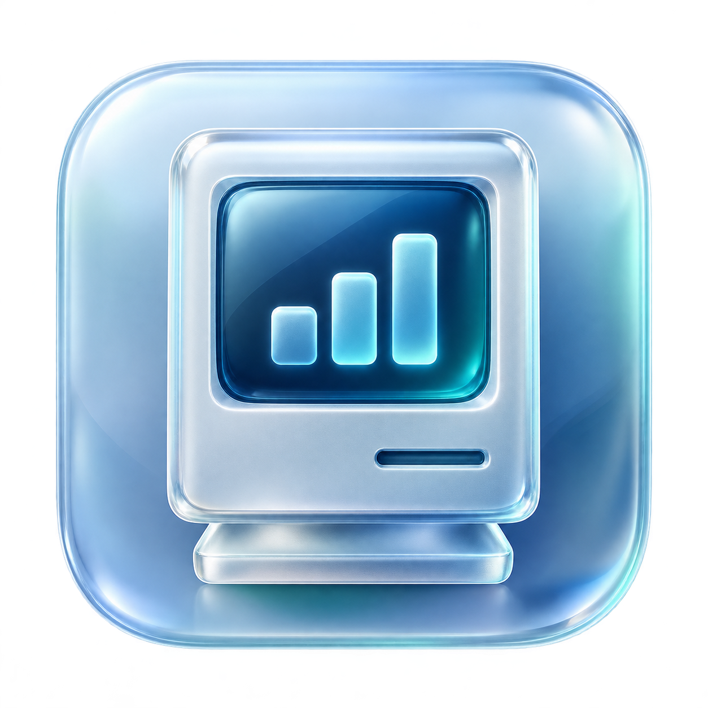

# Deng-Mac-monitor

<p align="center"></p>

> **AI 制作声明**：本项目的主要代码、界面实现、构建脚本及项目说明由 OpenAI Codex 在用户指导下辅助生成和修改；应用图标使用 AI 图像生成工具制作。第三方组件和参考项目的作者及许可证单独列出。本项目为实验性工具。

一个简洁的 Apple Silicon Mac 菜单栏性能监测工具。使用原生 SwiftUI / AppKit，跟随系统浅色与深色外观。

## 使用

构建后双击 `dist/邓眼瞎.app`，直接打开性能面板，同时在 Dock 和菜单栏显示应用。菜单栏显示液态玻璃图标和整机总功耗（W），点击打开图标下方的紧凑面板。再次点击图标、点击面板外部、按 Esc 或点击面板右上角关闭按钮，都可收起面板，无需退出软件。主面板右上角也显示整机总功耗。关闭窗口后仍可在菜单栏查看数据；再次双击应用或点击 Dock 图标会重新显示窗口。在面板右下角退出应用。

- 整机总功耗：读取 macmon 的 `sys_power`（系统传感器报告值），不使用 CPU / GPU / ANE 功耗之和代替。数据缺失或采集断开时显示 `— W`。这是系统传感器口径，不等同于插座功率计或充电器输入功率。
- CPU：系统 CPU 时间差计算的忙碌比例，附估算功耗和平均温度。
- GPU：活动时间比例，附估算功耗和平均温度。
- 内存：采集器报告的已用 / 总量，同时显示 Swap。口径可能与活动监视器不同。
- Neural Engine：主值为 ANE 内存读写合计速率，按量级显示 MB/s 或 GB/s，同时分别显示读、写速率及估算功耗。
- ANE 活动率：从 `SoC Stats / Cluster Power States` 中 ANE 簇的 ACT 驻留时间计算，取最忙簇的比例。不是算力利用率；通道缺失、没有 ACT 状态、或没有有效时间数据时显示“不可用”。本机 M4 / macOS 26.3 未提供此活动率通道。
- 本机吞吐量来源：`AMC Stats / Perf Counters` 的 `ANE DCS RD` 和 `ANE DCS WR` 字节增量，除以实际单调时钟采样间隔。只统计 DCS 通道，避免把 AF 流量重复相加。数字是系统计数器报告的 ANE 内存流量，不是每秒推理次数或 TOPS。
- 其他机器若无法读取字节通道，可尝试 PMP 的 ANE 读写合计带宽分档；此时明确标注“估算”，读写明细显示 `—`。分档存在精度及高位饱和限制。
- 0.00 W 表示采样功耗低于显示精度，不能据此断定没有任何任务。

每秒采样。断开时清除过期的采集器数据并自动重试，缺失的指标显示 `—`。ANE 字节计数直接在应用内读取，不依赖 macmon；系统睡眠或采样间隔超过 5 秒时重新建立基线，避免把长时平均值当成实时速率。

## 下载与运行条件

- 仅支持 **Apple Silicon（M 系列）Mac**，不支持 Intel Mac、Windows 或鸿蒙。
- [现有 v1.3.0 发布包](https://github.com/thangshanshang/Deng-Mac-monitor/releases/tag/v1.3.0) 的主程序实际最低部署版本为 **macOS 26.0**。该包的 Info.plist 写有 14.0，但不能据此在 macOS 14/15 上运行；这是旧构建脚本未固定编译目标造成的，当前源码已修正。
- 当前源码明确以 **macOS 14.0** 为最低部署目标；这表示编译目标，不代表完成了所有系统和芯片的兼容性测试。目前只在 **M4 / macOS 26.3** 上实测，旧系统和其他芯片的采集通道仍需验证。
- 发布包已内置 macmon，使用者无需安装 Homebrew、Xcode 或 Swift。正常采集无需 sudo 或管理员密码；安装开发工具和系统安全确认可能需要认证。

下载 Release 中的 `Deng-Mac-monitor-v1.3.0-macOS-arm64.zip`（不要选择 Source code），解压后将 `邓眼瞎.app` 拖入“应用程序”再打开。应用采用 ad-hoc 临时签名，**没有 Developer ID 签名和 Apple 公证**，从网上下载后可能被 Gatekeeper 拦截。请先核对下载来源；若系统允许，可按 Apple 的[安全打开 Mac App 说明](https://support.apple.com/zh-cn/102445)在“系统设置 → 隐私与安全性”中处理，或自行从源码构建。无需关闭系统整体安全保护。

本项目及 macmon 使用私有 IOReport / 系统传感器接口，系统更新后可能需要适配；缺失的指标显示 `—` 或“不可用”。应用只读取本机指标，没有网络上报、开机启动或历史数据存储。采集器会随应用退出。

## 从源码构建

构建需要：

- Apple Silicon Mac，使用原生 arm64 终端，不使用 Rosetta。
- 提供 **Swift 6.x** 和 macOS SDK 的 Xcode Command Line Tools 或完整 Xcode；仅安装旧版命令行工具不够。工具链自身可能要求比部署目标更高的 macOS 版本，请以对应 Xcode/CLT 的系统要求为准。
- [Homebrew](https://brew.sh/) 和通过它安装的 `macmon`。构建脚本同时打包其二进制与 Homebrew 安装目录中的 `LICENSE`，仅复制一个 macmon 可执行文件到 PATH 不够。当前验证的采集器版本为 **macmon 0.10.0**；未来版本需重新确认输出字段和兼容性。

未安装开发工具时，先运行 `xcode-select --install` 并完成系统安装提示；安装 Homebrew 后，再执行：

```sh
# 应显示 Swift 6.x；若版本不符，先更新或选择正确的开发工具
xcrun swiftc --version

brew install macmon
macmon --version

git clone https://github.com/thangshanshang/Deng-Mac-monitor.git
cd Deng-Mac-monitor
zsh build.sh
open "dist/邓眼瞎.app"
```

若下载的是源码 ZIP，先解压并在终端进入包含 `build.sh` 的项目目录，再执行最后两条命令。输出为 `dist/邓眼瞎.app`，采集器、图标及第三方许可证均随应用打包，不需要服务器或额外部署服务。构建不需要 Apple 付费开发者账号。

`swift build -c release` 只构建 Swift Package 可执行文件，**不会生成完整 .app 或打包 macmon、图标和许可证**；普通安装请使用 `zsh build.sh`。构建脚本固定 `arm64-apple-macosx14.0` 并写入一致的最低系统版本。实际兼容性还取决于所用 Swift 工具链及打包的 macmon；修改部署目标不能代替旧系统实测。

## 第三方与 AI 素材

采集组件：[vladkens/macmon](https://github.com/vladkens/macmon)，MIT 许可证随应用保存在 `Contents/Resources/macmon-LICENSE`。

ANE 通道映射参考 [SiliconScope](https://github.com/kennss/SiliconScope)，MIT 许可证保存在源码 Support/SiliconScope-LICENSE 和应用 Contents/Resources/SiliconScope-LICENSE。

图标的 AI 生成说明和提示词见 [Design.md](Support/Assets/Design.md)。上述 AI 声明不改变第三方代码及组件的原有版权和许可证。

## 1.3.0 改进

菜单栏改为整机功耗；替换菜单栏图标；用显式定位的 300 × 415 紧凑面板替代原弹窗，增加重复点击、外部点击、Esc 和关闭按钮四种收起方式。
